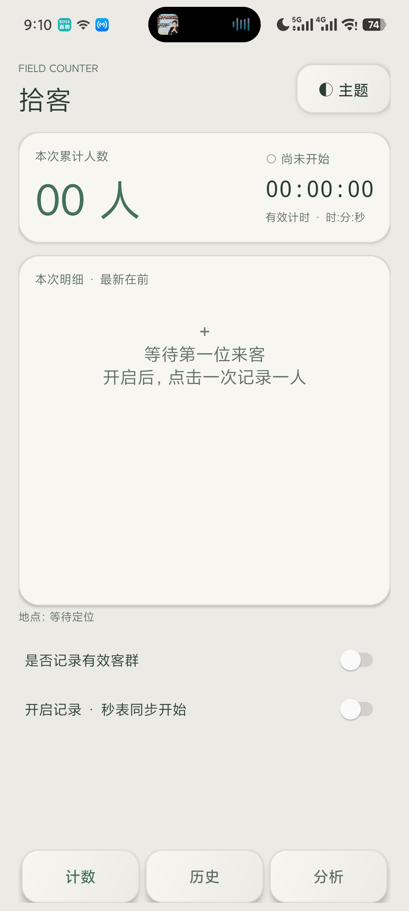

# 拾客 Shike Counter

Android 本地客流计数工具。奶油机械浅色主题、深色仪表主题，可手动切换或跟随系统。项目使用 Java 17 和原生 Android View，无第三方运行时依赖。支持 Android 8.0（API 26）及以上。

当前版本：1.1.0。源码仓库：[NothingBigger1/ShikeCounterSource](https://github.com/NothingBigger1/ShikeCounterSource)。

## 实机效果图

以下为用户提供的小米14真实使用截图，版本为 **1.0.0（优化前）**。图中的系统默认开关、分离式底部按钮属于旧版样式；1.1.0 已优化为机械拨钮和一体式导航座，新版实机截图待补充。



### 1.1.0 界面更新

- 独立绘制的机械拨钮：凹槽轨道、金属边缘、带阴影的实体拨头，不再依赖厂商系统 Switch 外观。
- 底部三入口合并为一个导航座，绿色填充、文字及无障碍选中状态标记当前页面。
- 显式处理状态栏、系统导航、刘海、强制手势安全区，额外留出20dp底部间距，隐藏手势横条时也不贴边。
- 常规竖屏保持约70/30分区；窄小屏幕和大字体改为可滚动内容；横屏使用左右分区；大屏内容最大宽度720dp。
- 页面切换180ms淡入与轻位移，按钮65ms按下/140ms回弹，拨钮180ms移动；尊重系统动画关闭选项。
- 全部材质由原生矢量与渐变绘制，无第三方图片素材或授权依赖。

## 使用方法

1. 初次打开仅显示“是否记录有效客群”和“开启记录”两个操作开关。默认不分类。
2. 开启记录后开始新场次，秒表从零计时，开启开关由暂停按钮替换。
3. 不分类时点击“记录 +1”，新增一条“通用”记录；分类时显示“已购买 +1”“未购买 +1”，每次点击新增一人。
4. 暂停后禁止计数，暂停按钮由结束按钮替换，同时提供继续记录按钮。
5. 结束并确认后归档场次、清空当前列表和秒表，恢复初始开关。空场次也保存。
6. 历史页选择起止日期与时间，查看与范围相交的已结束场次。点击场次查看**完整**明细和秒表时长。
7. 分析页查看所选范围内的新增人数折线图和客群人数柱状图。转化率 = 已购买 ÷（已购买 + 未购买）；通用不参与分母。没有分类记录时显示“—”。
8. 主题按钮提供跟随系统、奶油机械浅色、深色仪表三档，选择会保存。

## 记录与定位

- 每次点击先写入 SQLite，再更新界面；手机本地时间显示至秒。相同秒内的多次点击保留独立记录ID，不会合并。
- 记录包含时间、客群类别、人数1、地址、经纬度、定位精度、位置采集时间。
- 使用系统 GPS / 网络定位，无地图 API Key。仅在进行中的场次且应用位于前台时请求定位；后台不采集位置。
- 定位权限首次开启时请求，拒绝后不反复弹窗，可通过主题菜单中的“定位权限设置”重新授权。
- 使用最近120秒内、精度不劣于200米的位置快照。该阈值用于拒绝过旧/过差位置，不能保证实际定位误差。
- 坐标采用系统 Location 的 WGS84 原始坐标。界面不显示经纬度。
- 地址由系统 Geocoder 异步解析。系统地理编码服务、网络和地区支持影响实际结果。失败时显示“地址暂不可用”，有坐标时仍保留坐标；拒绝权限、无合格位置时显示“未获取位置”，不生成假坐标。
- 本地数据库位于应用私有目录，不提供云端同步；卸载应用会删除记录，请及时导出。

## 秒表与恢复

- 用 `SystemClock.elapsedRealtime()` 计算有效时长，不受调整系统日期时间影响。
- 暂停冻结，继续累加，包含后台经过时间，不包含手动暂停时间。
- 场次起点、累计时长、计时基准和状态持久保存，正常关闭或同一次开机内被系统回收后可恢复。
- 检测到设备重启时将运行场次转为暂停，保留最近已落盘的有效时长；不会推测重启过程中是否在记录。未结算的运行段可能丢失，应在关机前暂停或结束。
- 场次汇总显示起止时间、有效计时、总跨度。总跨度包含暂停时间。

## Excel 与微信

- 生成标准 OOXML `.xlsx`，无宏、无公式；所有字段作为文本输出，防止地址等内容被当成 Excel 公式。时间格式 `yyyy-MM-dd HH:mm:ss`。
- “记录明细”表：明细ID、场次ID、记录时间、人数、客群类别、地址、纬度、经度、精度、位置采集时间、时区。
- “场次汇总”表：起止时间、有效计时（格式与秒数）、场次总人数、筛选内人数/类别人数、筛选边界。
- 历史范围导出仅包含已结束场次，明细严格落在时间范围内；汇总区分完整场次人数与筛选内人数。单场次导出包含整个场次。
- 导出后可通过系统文档选择器保存到指定文件夹，或通过系统分享面板选择微信。
- 共享使用只读 ContentProvider 与临时 URI 权限。未安装微信时仍可保存或分享给其他支持 Excel 的应用。不会自动选择联系人或发送消息。

## 界面约定

- 扣除应用标题与底部菜单后，计数主内容上方70%为累计/秒表/明细，下方30%为操作区域。
- 大触控按钮、按压位移反馈、轻触觉反馈，阴影和渐变体现机械按键层次。
- 明细界面显示最近300条以限制视图数量，数据库和导出保留全部记录。
- 日期时间筛选器以分钟选择，起点按该分钟00秒、终点按该分钟59.999秒纳入。
- 图表时间粒度支持分钟/小时/天，最多48个点，大范围自动合并。当前“天”按固定24小时区间计算，跨夏令时不是自然日；中国时区不受此影响。

## 编译

环境：JDK 17、Android SDK Platform 34、Build Tools 34.0.0、Gradle 8.2。Android Gradle Plugin 8.1.2。

```powershell
$env:JAVA_HOME='你的JDK17目录'
$env:ANDROID_HOME='你的AndroidSDK目录'
.\gradlew.bat assembleDebug
```

也可在 Android Studio 中打开本目录，设置 SDK 后编译。APK 输出为 `app/build/outputs/apk/debug/app-debug.apk`。正式发布前需使用自己的长期签名密钥配置 release 签名，妥善备份，不要提交至 GitHub。

## 工程结构

- `MainActivity.java`：原生界面、主题、定位权限、图表、历史筛选、导出分享。
- `CounterStore.java`：SQLite 表结构、持久化状态、场次/明细查询。
- `ExcelExporter.java`：不依赖第三方库的 OOXML 导出。
- `ExportProvider.java`：限定导出目录的只读分享 Provider。
- `MechanicalSwitch.java`：跨厂商统一的机械开关。
- `InstrumentSurface.java`：仪表凹槽/浮雕表面绘制。
- `app/src/test/.../InterfaceTest.java`：尺寸、导航状态、分类计数和大字体测试。
- `.github/workflows/android.yml`：GitHub Actions 编译 Debug APK。
- `docs/验收清单.md`：功能验收和当前验证边界。

应用无需登录。当前版本没有撤销/删除、多人同步、后台定位或服务端功能。
